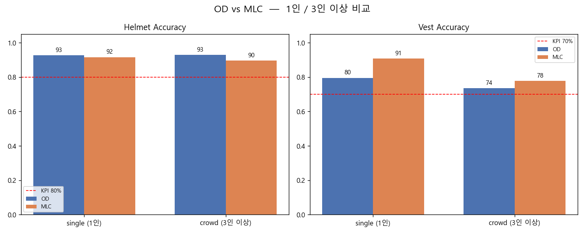
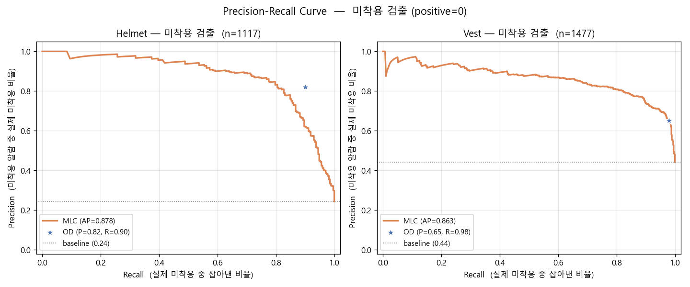

# Safe Eye — On-Device AI 산업 현장 안전 감지 시스템

고정 카메라 비전으로 작업자의 **PPE(안전모·안전조끼) 미착용**과 **위험구역 접근**을
네트워크 없이 단말(Raspberry Pi 5)에서 실시간으로 감지하고, 화면 오버레이와 음성으로 경고합니다.

> AI융합로봇 과정 3기 · 3조 팀 프로젝트 (2026)

`Raspberry Pi 5` `Python` `YOLO11` `MobileNetV3` `TFLite` `OpenCV`

---

## 팀 구성과 담당

| 이름 | 담당 |
|---|---|
| 양시영 | 시스템·아키텍처 설계, PPE 모델 정량 성능 평가 |
| 류상균 | PPE OD(객체 탐지) 모델 설계·학습, 하드웨어·임베디드 구동 시스템 |
| **채윤식** | **PPE MLC(멀티라벨 분류) 모델 설계·학습, 위험구역 감지 시스템** |
| 박희연 | 학습·평가 데이터 전처리, 시스템 통합·프론트엔드 대시보드 |

### 채윤식 담당 코드

| 경로 | 내용 |
|---|---|
| `training/MLC_Tranining.ipynb` | MobileNetV3Large 멀티라벨 분류 모델 학습 |
| `training/danger zone_Tranining.py` | 위험 표지판 YOLO11n 학습 |
| `Danger/` | 위험 표지판 탐지 → Danger Zone 생성 → 진입 판정 모듈 |

---

## 동작 흐름

```
IR 센서 감지 → 카메라 최신 프레임 → YOLO person 감지
  → 1명: MLC 분류 (MobileNetV3, 상체 크롭)
  → 2명+: YOLO OD (helmet/vest bbox)
  → 위험 표지판 감지 → 위험 구역 판정
  → 위반 시 스피커 경고 + 화면 표시
  → 브라우저 대시보드 실시간 업데이트
```

PPE 판별과 위험구역 판정은 단말 하나에서 동시에 수행됩니다.
IR 센서가 사람을 감지했을 때만 AI 추론을 활성화해 전력·연산 부담을 줄였습니다.

---

## 담당 파트 상세

### 1. PPE MLC 모델 — MobileNetV3Large 멀티라벨 분류

- **구조**: person 상체 크롭 → MobileNetV3Large(ImageNet 사전학습) → Sigmoid × 2 (`helmet_prob`, `vest_prob`, 임계값 0.5)
- **Loss / Optimizer**: Binary Cross-Entropy / Adam
- **문제**: 상태 코드별 데이터 분포가 극단적 (헬멧O·조끼X 약 25,000장 vs 헬멧X·조끼O 약 900장) → 다수 클래스에 편향 학습
- **시도**: Class Weight, Data Augmentation 단독 적용 → 학습 불안정·과적합
- **해결**: 희소 클래스 전량 사용 + 다수 클래스 클래스별 최대 1,000장 균등 샘플링, Stratified 3분할(70/15/15), EarlyStopping
- **결과**: Validation 정확도 **헬멧 91.0% · 조끼 91.8%** (KPI 80% 상회)
- 배포용 TFLite 변환 (FP32 / INT8) — `models/`

### 2. 위험구역 감지 시스템 — 표지판 기반 자동 영역 설정

1. YOLO11n으로 위험 표지판 탐지 (고정 위치이므로 30프레임마다 탐지 후 캐시 재사용)
2. 표지판 bbox를 확장해 Danger Zone polygon 생성 (설치 환경별 확장계수 튜닝)
3. person bbox 하단 중심(발 위치)이 polygon 안에 들어오면 즉시 **DANGER** 경고

- 학습: YOLO11n · 1,915장 · img 416
- 결과: **Precision 1.000 · Recall 0.940** · F1 0.810 · mAP@0.5 0.787
- 표지판이 정확한 위치에 있어야 영역이 올바르게 잡히므로 Precision을 우선 최적화

---

## 팀 전체 결과 — OD vs MLC 공정 비교

OD 학습셋과 분리된 독립 GT 평가셋(총 1,477명)에서, 동일한 person 박스를 공유해 두 방식을 비교했습니다.

| 환경 | Helmet OD | Helmet MLC | Vest OD | Vest MLC |
|---|---:|---:|---:|---:|
| single (1인) | **92.6%** | 91.6% | 79.6% | **90.8%** |
| crowd (3인 이상) | **92.8%** | 89.6% | 73.6% | **77.8%** |
| 전체 | **92.8%** | 90.4% | 76.0% | **83.0%** |

<sub>출처: `tests/Results/OD_Old/summary_metrics.csv` (결과보고서 기준)</sub>

- 헬멧은 OD, 조끼는 MLC가 일관되게 우세
- MLC는 사람 수만큼 추론하므로 다인원에서 FPS가 선형 하락 (PC 기준 1인 3.48 → 다인원 1.92 FPS)
- 결론: **1인은 MLC(정확도 우선), 2인 이상은 OD(실시간성 우선)** 하이브리드 파이프라인 채택
- 이후 OD 추가 학습(epoch 20 → 60)으로 OD 1인 조끼 정확도가 89.3%까지 상승 — `tests/Results/OD_New/`

<p>
  
  
</p>

---

## 실행 방법

```bash
cd safe-eye
python3 ui/safe_eye_danger.py --host 0.0.0.0 --port 8000
```

브라우저에서 `http://<라즈베리파이IP>:8000` 접속

## 폴더 구조

```
safe-eye/
├── ui/                     웹 서버 진입점 + 브라우저 대시보드
├── Main/detector.py        PPE 분류기 (TFLite/PyTorch 자동 선택)
├── Danger/                 위험 표지판 감지 · Danger Zone 판정
├── vision/camera.py        LatestFrameCamera (최신 프레임 1장 버퍼)
├── sensor/ir_sensor.py     IR 센서 트리거
├── speaker/                음성 경고 (30초 cooldown, 위험구역 > PPE 우선순위)
├── training/               MLC · OD · 위험 표지판 학습 코드
├── Data preprocessing/     person 크롭 · 라벨 변환
├── tests/                  OD vs MLC 평가 스크립트 · 결과 그래프
├── models/                 PPE MLC TFLite (FP32 / INT8)
└── docs/                   수정 로그 · 작업 보고서
```

## 저장소에 포함되지 않은 것

- YOLO 가중치(`.pt`): person detector, PPE OD(`best.pt`), 위험 표지판 모델 — 용량 문제로 제외
- 학습 데이터셋 및 GT 평가 이미지 — 공개 데이터셋(Kaggle HardHat-Vest, Roboflow Construction Site Safety 등) 기반
